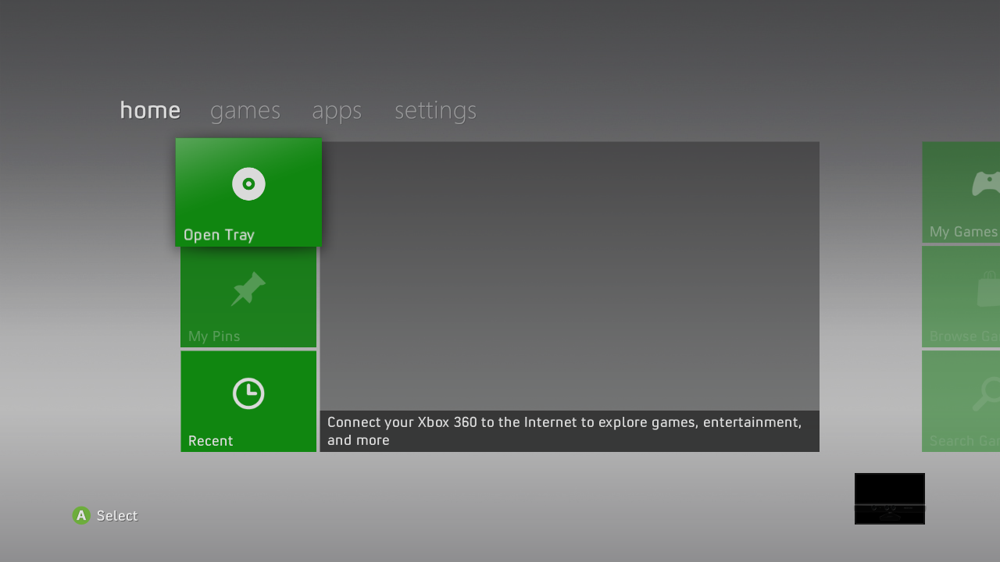
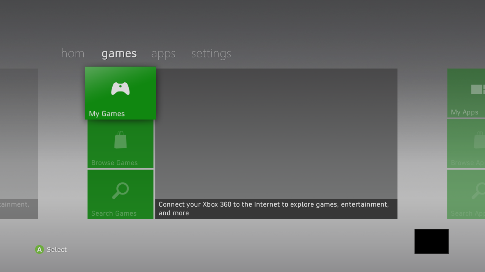
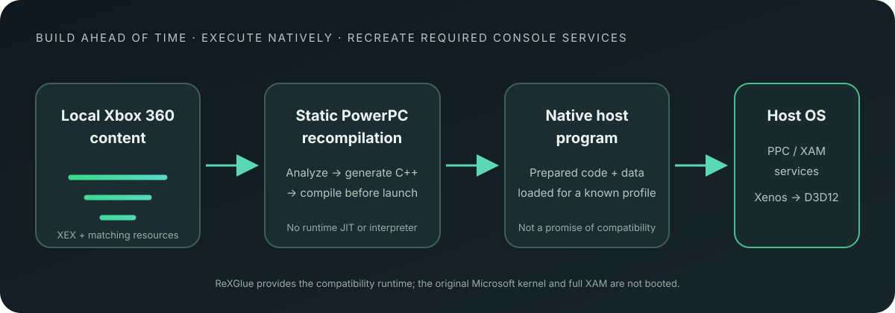

  

  # x360-native

  **An open research platform for running Xbox 360 software through static PowerPC recompilation.**

  
  
  

  [English](README.md) · [Português (Brasil)](README.pt-BR.md) · [Documentation](docs/README.md) · [Contributing](CONTRIBUTING.md)

> **Experimental software. Compatibility is limited and varies by exact dashboard and game version.** Windows x64 is the only platform with current end-to-end evidence. No game is certified as fully functional.

## What is x360-native?

x360-native explores a different way to run Xbox 360 software on a modern PC. Instead of translating PowerPC instructions while a game is running, it analyzes the original code ahead of time, generates C++, and compiles that code into a native host executable. At launch, the project still needs a compatibility runtime to provide console services and translate Xbox 360 graphics work.

In plain terms: **the game’s processor code is prepared before launch; the console environment is still recreated while it runs.** Static recompilation is not the same as “no emulation,” and compiling a game does not mean it is playable.

The project also works to run the **original Xbox 360 dashboard** as its own target. The dashboard is the console’s home interface: it provides the original menu and, where supported, launches prepared games through **My Games**. The desktop app helps import and prepare local content; it does not replace the dashboard.

## Why this project?

- **Ahead-of-time native code:** PowerPC instructions are translated and compiled before execution; there is no runtime JIT or instruction interpreter in the main path.
- **The original interface is part of the goal:** dashboard boot, navigation, My Games, game launch, and return are tracked as explicit compatibility flows.
- **Evidence before claims:** “compiled,” “boots,” “renders,” and “playable” are separate states. Results are tied to the exact content and version tested.
- **Version-safe originals:** a dashboard profile uses only its own matching original modules and resources. A filename or matching export is not enough to establish compatibility.
- **Performance with correctness:** performance is a core goal, but speed claims require comparable measurements and must preserve behavior and graphics fidelity.

## Current status · 17 October 2026

The primary demonstrated configuration is **Windows x64 with the Xenos D3D12 graphics backend**. Other operating systems and CPU architectures are goals, not supported releases. The source tree has newer work than the published preview; a recorded result does not automatically certify a new build or a different content dump.

| Target | What has been demonstrated | What is still missing |
|---|---|---|
| **Retail Dashboard 17559 (Metro)** | Original boot intro with audio, dashboard text and navigation, My Games, local profile flows, and return from tested games. | Many system services and settings remain partial. Only one active local user in slot 0. |
| **Retail Dashboard 6717 (Blades)** | Builds; historical navigation observations. | Matching font/resource is missing and a later smoke crashed. Diagnostic target only; no guided compatibility session. |
| **Castle Crashers 0.0.1.3** | Original launch from 17559, menu/input/rendering observations, and return to the dashboard. | Campaign, commercial entitlement, and game save/load are not certified. |
| **Forza Horizon 0.0.0.10** | Driving with input and audio, then Guide/Xbox Home return to 17559. | Campaign and save/load are not certified; later renderer experiments do not inherit production compatibility. |
| **Motocross Madness 0.0.0.3** | Tutorial movement and objectives; an opt-in avatar service was exercised. | Black terrain and a deformed rider; full races and save/load are not validated. |
| **Iruka / Dolphin sample** | Rendering and animation regression checks. | Input, audio, normal shutdown, and long sessions are not validated. |
| **Charlie Murder 0.0.0.2** | Import, AOT build, and launch from My Games. | Stops at a missing AOT function; not playable. |
| **Native D3D12 renderer** | Experimental dashboard/game flows were observed. | Development is suspended; performance is not approved, an occlusion query is missing, and Vulkan is unavailable. Xenos results do not transfer to Native. |

**No listed game is certified as Playable or Fully Functional.** A short launch, a successful build, or reaching a menu does not establish complete gameplay, progression, saves, or overall compatibility. The detailed [compatibility matrix](docs/compatibility.md) and dated [project status](STATUS.md) contain evidence and qualifications.

### What the compatibility labels mean

| Label | Meaning |
|---|---|
| **Identified / Imported** | Content was recognized or added to the local library. |
| **Compiled** | A native build completed for the identified inputs. The program may still fail at launch. |
| **Boots** | The original program started. This says nothing by itself about visible output or gameplay. |
| **Renders** | A visual scene was observed. Input, audio, progression, and persistence may still be missing. |
| **In-game** | Some gameplay was reached or observed. This does not imply sustained playability. |
| **Playable** | Relevant sustained gameplay and progression were validated, including the applicable input and persistence flows. None of the games listed above has this certification. |
| **Fully Functional** | Relevant end-to-end features and flows are verified. No game or dashboard is claimed fully functional. |

## Original dashboards and version isolation

The long-term goal includes original dashboard generations such as Blades, NXE, Kinect, and Metro, including older builds and betas from the local archive. **The active, demonstrated dashboard work is Retail 17559.** Dashboard 6717 is currently diagnostic; other versions remain pending until their matching inputs and behavior are validated.

Each version must use its own original `vk.xex`, sign-in/profile modules, XUI, skins, fonts, and other version-specific resources. The project records provenance and SHA-256 identity for profile inputs and rejects missing or mismatched dependencies instead of silently borrowing files from another dashboard. Shared generic runtime infrastructure is allowed; original version-specific files are not shared across profiles.

The 17559 `vk.xex` is the identified Retail 17559 component. The 13604 `vk.xex` is incompatible and must not be used as a substitute. See the [dashboard evidence](docs/dashboard.md) and [version-isolation diagram](docs/assets/dashboard-isolation.svg).

## See the original dashboard

These are real 1280×720 GPU readback screenshots captured on 14 October 2026 during a dashboard navigation comparison. Home uses the default **Xenos / D3D12** backend. Games uses the **experimental Native D3D12** backend, whose development is suspended and whose performance is not approved. They show dashboard states, not gameplay or a performance benchmark, and the two images are not a backend comparison.

| Dashboard 17559 · Home · Xenos | Dashboard 17559 · Games · Native experimental |
|---|---|
|  |  |

Capture metadata and hashes are retained in [`captures.json`](docs/evidence/native-n2-2026-10-14/captures.json); the full evidence set is under [`docs/evidence/`](docs/evidence/). The Games screenshot is from `native-games.png`, where the Games tab and My Games tile are visible. The banner above is original conceptual artwork, not a screenshot or compatibility claim.

## How it works

1. **Use your own authorized files.** The repository does not provide Xbox games, dashboards, firmware, fonts, or proprietary assets.
2. **Identify and prepare a specific content set.** Inputs are checked and associated with hashes and a title/dashboard profile.
3. **Generate and compile code ahead of time.** PowerPC code becomes C++, then a host-native build. This does not fill in missing kernel, XAM, file-system, audio, input, or graphics behavior.
4. **Run through the compatibility runtime.** ReXGlue supplies much of the runtime foundation. Xbox 360 Xenos GPU commands and shaders are still translated to a host graphics API. The complete original Microsoft kernel, firmware, and XAM are not booted.
5. **Validate the actual flow.** The original dashboard can launch a prepared title and handle a demonstrated return request. Each dashboard version and game build needs its own evidence.

More detail: [architecture and decisions](docs/architecture.md), [universal library and preparation](docs/guides/universal-library.md), [content layout](docs/guides/content-layout.md).

## Download and try the preview

**[Download the experimental Windows x64 preview](https://github.com/fabegalo/x360-native/releases/tag/v0.1.0-preview.20).** The corrected `v0.1.0-preview.20` package is a technical preview, not a general compatibility release. A clean Windows first-use experience is not fully validated.

1. Download the Windows x64 application ZIP and its published SHA-256 file from the [preview page](https://github.com/fabegalo/x360-native/releases/tag/v0.1.0-preview.20). Do not use GitHub’s “Source code” archives as the app.
2. Extract the complete ZIP and run `x360-native.exe`. Keep its `data/` folder: it stores the local environment, imported content, preparations, and settings.
3. In the app, import dashboard files and games that you are authorized to use. The app identifies them and reports missing or unsupported components.
4. Prepare a supported dashboard and any game you want to try. The app obtains pinned tools with consent and compiles locally; additional Microsoft C++ build components may require their official installer.
5. Start the original dashboard. For the demonstrated reference, open **My Games** and launch the prepared Castle Crashers trial. Use the game’s **Return to Arcade** flow to return to the dashboard.

Preparation can fail for unsupported content, missing source files, or incomplete compatibility services. **Imported** and **prepared** are library states, not promises that a game will run. The package does not include proprietary content or the full build toolchain. See [preview installation and validation notes](docs/guides/desktop-preparation.md) and [the release record](docs/reports/maintenance/FIRST_RELEASE.md).

## Roadmap

These are goals, not promises of support dates or completed compatibility:

- Make first-time installation and preparation dependable on a clean Windows system.
- Expand version-specific support for original dashboards, beginning with the evidence and missing resources for each profile.
- Improve local profile, Guide, XAM service, and save behavior; validate actual game save/load separately from storage contract tests.
- Investigate more Xbox 360 titles through generic AOT improvements and reproducible title reports.
- Measure CPU, memory, GPU, and loading costs under comparable workloads; accept optimizations only when correctness and fidelity hold.
- Evaluate Linux, macOS, and ARM64 as separate platform targets with their own end-to-end validation.
- Explore XNA/Xbox Live Indie Games and original Xbox backward compatibility as longer-term research.

Progress and acceptance criteria live in the [functional checklist](docs/CHECKLIST_FUNCIONAL_x360-native.md). See the [performance methodology and roadmap](docs/performance.md) for performance work.

## FAQ

<strong>Does “native” mean no emulation?</strong>

No. The game’s PowerPC code is compiled ahead of time, but the console’s services and Xenos graphics pipeline still need compatible implementations. The GPU commands and shaders are translated for the host.

<strong>Can I play every Xbox 360 game?</strong>

No. The catalog-wide goal is long term. Importing, identifying, or compiling a game does not mean it boots or is playable. Check the exact title and version in the compatibility matrix.

<strong>Can I use any dashboard files I find?</strong>

No. Use legally obtained files, and keep each dashboard’s original modules and assets with the matching version profile. A component from another version may be incompatible even when its filename or exports match.

<strong>Does it support Linux, macOS, or ARM?</strong>

They are goals. Current end-to-end evidence is for Windows x64; other platform builds do not establish runtime support.

<strong>Are saves, Xbox Live, multiplayer, and peripherals supported?</strong>

Some local profile and storage contracts are implemented, but commercial game save/load is not demonstrated. Xbox Live, online multiplayer, and special peripherals are outside the validated scope.

<strong>Why does a title stop after compiling?</strong>

It may depend on a missing PowerPC function, an unimplemented XAM/kernel export, an unsupported resource, or runtime behavior that has not been reproduced. The project keeps these failures visible rather than treating a successful build as compatibility.

<strong>Does the project distribute Xbox software?</strong>

No. Provide only content you are authorized to use. Do not submit games, dashboards, XEX files, fonts, firmware, saves, proprietary assets, or generated code derived from proprietary binaries.

## Contributing

Contributions are welcome in documentation, reproducible bug reports, synthetic tests, compatibility evidence, and focused fixes. Start here:

1. Read [CONTRIBUTING.md](CONTRIBUTING.md), [STATUS.md](STATUS.md), and the relevant [architecture](docs/architecture.md) or [compatibility](docs/compatibility.md) notes.
2. Use an exact content version/hash, project revision, platform, steps to reproduce, and sanitized logs when reporting a compatibility issue. Never attach proprietary content or personal data.
3. Keep changes focused. For code, add a regression test for the affected contract where practical and run the smallest relevant validation; do not treat a compile or short smoke as gameplay certification.
4. Preserve version isolation, PPC/XAM semantics, and measured performance evidence. See [performance contribution expectations](CONTRIBUTING.md#performance-changes).
5. Use Conventional Commit messages such as `docs(readme): clarify compatibility status`. Open a pull request against `main`; no game files or generated binaries should be included.

The project is primarily documented in English and Portuguese today; international contributions that improve clear, evidence-based documentation are especially useful. For security reports, follow [SECURITY.md](SECURITY.md).

## Documentation

| Start here | What it covers |
|---|---|
| [Project status](STATUS.md) | Current evidence, recent changes, and known limits |
| [Compatibility matrix](docs/compatibility.md) | Per-dashboard and per-game results |
| [Architecture](docs/architecture.md) | Static recompilation, runtime boundaries, and process model |
| [Dashboard](docs/dashboard.md) | Original interface, modules, profiles, and launch/return evidence |
| [Build guide](docs/guides/BUILDING.md) | Developer prerequisites and local build workflow |
| [Universal library](docs/guides/universal-library.md) | Import, identification, AOT preparation, and receipts |
| [Performance](docs/performance.md) | Measurement policy and roadmap |
| [Documentation index](docs/README.md) | Engineering documents and reports |

## Licensing and project independence

Project code is licensed under [BSD-3-Clause](LICENSE). Dependencies keep their own licenses; see [third-party notices](THIRD_PARTY_NOTICES.md) and the [license audit](docs/reports/maintenance/LICENSE_AUDIT.md). x360-native is independent and is not affiliated with or endorsed by Microsoft. Xbox names and marks belong to their respective owners. Recompilation does not grant rights to redistribute original software or assets.

Thanks to the [ReXGlue project](https://github.com/rexglue/rexglue-sdk) and its contributors, and to the Xenia work on which ReXGlue’s compatibility runtime is based.
