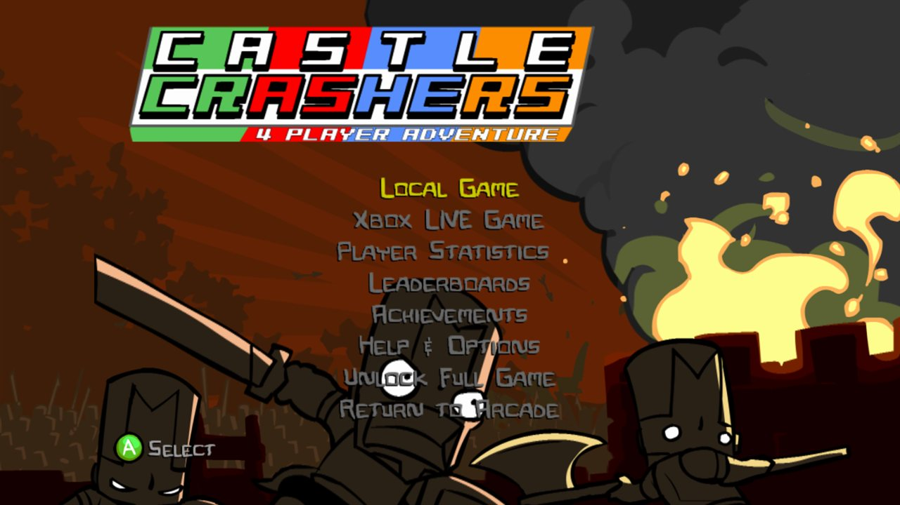
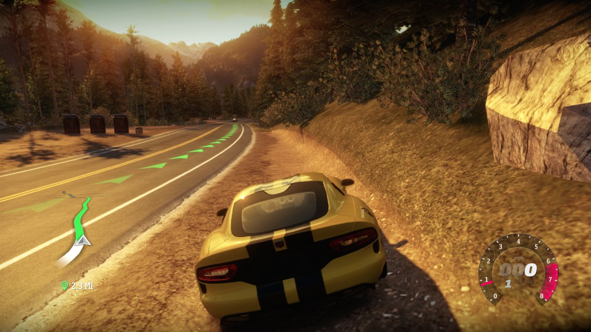
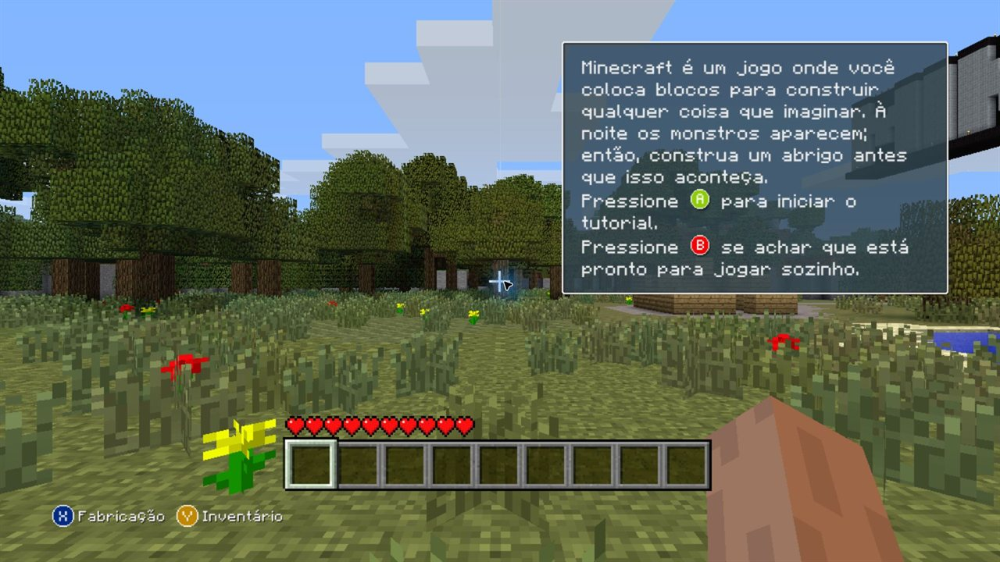

  

  # x360-native

  **Uma plataforma de pesquisa aberta para executar software do Xbox 360 por recompilação estática de PowerPC.**

  
  
  

  [English](README.md) · [Português (Brasil)](README.pt-BR.md) · [Documentação](docs/README.md) · [Como contribuir](CONTRIBUTING.md)

> **Software experimental.** Windows x64 é a única plataforma com evidências de ponta a ponta, os resultados dependem da versão exata da dashboard e do jogo, e nenhum jogo está certificado como plenamente funcional.

## Veja funcionando

| Dashboard original 17559 · Início | Dashboard 17559 · Aba Games |
|---|---|
|  |  |
| **Castle Crashers** · menu principal | **Forza Horizon** · estrada com HUD |
|  |  |
| **Forza Horizon 2** · tela de título (AOT genérico) | **Minecraft** · mundo do tutorial (AOT genérico) |
|  |  |

Capturas reais de sessões de teste locais, entre 13 e 27 de outubro de 2026, com o backend padrão Xenos D3D12. A captura da aba Games usa o backend experimental Native D3D12. Elas mostram estados alcançados, não jogabilidade certificada nem desempenho. As imagens de jogos e da dashboard pertencem aos respectivos donos.

## O que é o x360-native?

O x360-native analisa o código PowerPC original **antes** da execução, gera C++ e compila esse código num executável nativo para PC. O caminho principal não usa JIT nem interpretador de instruções. Um runtime de compatibilidade, baseado no [ReXGlue](https://github.com/rexglue/rexglue-sdk), ainda reproduz os serviços do console e traduz o trabalho gráfico do Xenos para a GPU do computador. Compilar um jogo não o torna jogável.

A **dashboard original do Xbox 360** é um alvo próprio: inicialização, navegação, My Games, início de um jogo preparado e retorno à dashboard são acompanhados como fluxos de compatibilidade. O aplicativo desktop importa e prepara o seu conteúdo local; ele não substitui a dashboard.

## Estado atual

Configuração principal: **Windows x64 com o backend Xenos D3D12.** Outros sistemas e arquiteturas são objetivos, não plataformas com suporte.

| Alvo | Alcançado | Ainda não certificado |
|---|---|---|
| **Dashboard 17559 (Metro)** | Intro e áudio originais, navegação, My Games, perfis locais, Guide, início de jogos e retorno | Vários serviços e configurações do sistema são parciais; um usuário local no slot 0 |
| **Castle Crashers** | Início pela 17559, menu, entrada, renderização, retorno à dashboard | Campanha, licença comercial, salvar/carregar |
| **Forza Horizon** | Direção com entrada e áudio, retorno à 17559 pelo Guide/Xbox Home | Campanha, salvar/carregar |
| **Minecraft** | Tutorial da versão trial, movimento e quebra de blocos (AOT genérico) | Salvar/recarregar, jogo prolongado |
| **Forza Horizon 2** | Direção inicial com HUD, minimapa e entrada (AOT genérico) | Campanha, salvar/recarregar, jogo prolongado |
| **Motocross Madness** | Movimento e objetivos do tutorial | Fluxo completo de My Games/perfil/Guide, corridas, salvar/carregar |
| **Charlie Murder** | Preparação AOT e roteamento pelo My Games; chegou ao bootstrap do NetCF | Inicialização do XNA, renderização, jogabilidade |
| **Dashboard 6717 (Blades)** | Compila; navegação histórica | Fonte/recurso correspondente ausente; apenas diagnóstico |
| **Native D3D12 / Vulkan** | Execução experimental e contratos sintéticos de GPU | Desempenho em jogo; resultados do Xenos não se transferem |

**Nenhum jogo listado está certificado como Jogável ou Plenamente funcional.** A [matriz de compatibilidade](docs/compatibility.md) traz as evidências e os limites por título e versão, e o [STATUS.md](STATUS.md) o registro datado.

<strong>O que significam os estados de compatibilidade</strong>

| Estado | Significado |
|---|---|
| **Identificado / Importado** | O conteúdo foi reconhecido ou adicionado à biblioteca local. |
| **Compilado** | Um build nativo foi concluído. O programa ainda pode falhar ao iniciar. |
| **Inicia** | O programa original começou a rodar; nada além disso. |
| **Renderiza** | Uma cena foi observada. Entrada, áudio, progressão e persistência podem faltar. |
| **Em jogo** | Alguma jogabilidade foi alcançada. Isso não implica jogo prolongado. |
| **Jogável** | Jogabilidade prolongada e progressão foram validadas, incluindo entrada e persistência. Nenhum jogo tem isso ainda. |
| **Plenamente funcional** | Todos os fluxos relevantes de ponta a ponta estão verificados. Nenhum jogo ou dashboard é declarado plenamente funcional. |

## Experimente a prévia

**[Baixe a prévia para Windows x64 (v0.69.27-preview.25)](https://github.com/fabegalo/x360-native/releases/tag/v0.69.27-preview.25)** · [notas da versão](docs/releases/0.69.27-preview.25.md)

1. Baixe o ZIP do aplicativo e o checksum SHA-256 na página da Release (não o arquivo "Source code" do GitHub).
2. Extraia e execute `x360-native.exe`. Mantenha a pasta `data/` ao lado dele: ela guarda biblioteca, preparações e configurações.
3. Importe os arquivos da dashboard e os jogos que você tem autorização para usar. O aplicativo identifica cada um e informa o que falta ou não é suportado.
4. Prepare a dashboard e os jogos que quiser testar. As ferramentas fixadas são baixadas com o seu consentimento e o código é compilado localmente; alguns componentes de compilação C++ da Microsoft podem exigir o instalador oficial.
5. Inicie a dashboard original, abra **My Games** e inicie um jogo preparado.

O pacote não contém conteúdo do Xbox. Importado ou preparado não significa que o jogo vai rodar, e o primeiro uso num Windows limpo ainda não foi verificado. Mais no [guia de preparação](docs/guides/desktop-preparation.md).

## Como funciona

1. **Use os seus próprios arquivos.** As entradas são identificadas por SHA-256 e associadas a um perfil de dashboard ou de título.
2. **Recompile antes da execução.** O código PowerPC vira C++ e depois um build nativo.
3. **Rode com o runtime de compatibilidade.** Serviços de kernel/XAM, armazenamento, entrada e áudio são reimplementados; comandos e shaders do Xenos são traduzidos para a GPU do computador. O kernel e o firmware originais da Microsoft não são inicializados.
4. **Valide o fluxo real** para cada versão de dashboard e build de jogo.

Mais: [arquitetura e decisões](docs/architecture.md) · [biblioteca universal](docs/guides/universal-library.md) · [estrutura de conteúdo](docs/guides/content-layout.md)

## Roadmap

Objetivos, não promessas:

- Instalação e preparação confiáveis no primeiro uso num Windows limpo.
- Mais versões originais da dashboard, cada uma com seus recursos e evidências.
- Perfis, Guide, serviços XAM e salvamento real de jogos mais completos.
- Mais títulos por melhorias no AOT genérico.
- Linux, macOS e ARM64 como alvos separados, com validação de ponta a ponta própria.

O progresso fica no [checklist funcional](docs/CHECKLIST_FUNCIONAL_x360-native.md).

## Perguntas frequentes

<strong>"Nativo" significa sem emulação?</strong>

Não. O código PowerPC do jogo é compilado antes da execução, mas os serviços do console e o pipeline gráfico Xenos ainda precisam de implementações compatíveis; comandos e shaders da GPU são traduzidos para o computador.

<strong>Posso jogar qualquer jogo de Xbox 360?</strong>

Não. Importar, identificar ou compilar um jogo não significa que ele inicia ou é jogável. Confira o título e a versão exatos na matriz de compatibilidade.

<strong>Posso usar quaisquer arquivos de dashboard que eu encontrar?</strong>

Não. Use arquivos obtidos legalmente e mantenha os módulos originais de cada dashboard com o perfil da versão correspondente. Um componente de outra versão pode ser incompatível mesmo com nome de arquivo ou exports iguais.

<strong>Funciona em Linux, macOS ou ARM?</strong>

São objetivos. As evidências atuais de ponta a ponta são para Windows x64; compilar em outra plataforma não comprova suporte em execução.

<strong>Saves, Xbox Live, multiplayer e periféricos são suportados?</strong>

Os fluxos locais de perfil e armazenamento estão implementados em parte, mas salvar/carregar em jogos comerciais não está certificado. Xbox Live, multiplayer online e periféricos especiais estão fora do escopo.

<strong>Por que um título para depois de compilar?</strong>

Ele pode depender de uma função PowerPC ausente, de um export XAM/kernel não implementado, de um recurso não suportado ou de um comportamento de runtime ainda não reproduzido. Essas falhas ficam visíveis em vez de serem tratadas como compatibilidade.

<strong>O projeto distribui software do Xbox?</strong>

Não. Nunca envie jogos, dashboards, arquivos XEX, fontes, firmware, saves, recursos proprietários ou código gerado a partir de binários proprietários.

## Como contribuir

Documentação, relatos de bugs reproduzíveis, testes sintéticos, evidências de compatibilidade e correções focadas são bem-vindos. Leia primeiro o [CONTRIBUTING.md](CONTRIBUTING.md). Ao relatar um problema de compatibilidade, informe a versão/hash exato do conteúdo, a revisão do projeto, a plataforma, os passos e logs sanitizados, nunca conteúdo proprietário ou dados pessoais. Use Conventional Commits (`docs(readme): clarify compatibility status`). Relatos de segurança seguem o [SECURITY.md](SECURITY.md).

## Documentação

| Comece por | O que cobre |
|---|---|
| [Estado do projeto](STATUS.md) | Evidências atuais, mudanças recentes e limites conhecidos |
| [Matriz de compatibilidade](docs/compatibility.md) | Resultados por dashboard e por jogo |
| [Arquitetura](docs/architecture.md) | Recompilação estática, fronteiras do runtime e modelo de processos |
| [Dashboard](docs/dashboard.md) | Interface original, módulos, perfis e evidências de início/retorno |
| [Guia de build](docs/guides/BUILDING.md) | Pré-requisitos e fluxo de build local para desenvolvimento |
| [Desempenho](docs/performance.md) | Política de medição e roadmap |
| [Índice da documentação](docs/README.md) | Todos os documentos técnicos e relatórios |

## Licença

O código do projeto usa a licença [BSD-3-Clause](LICENSE). As dependências mantêm suas próprias licenças; veja os [avisos de terceiros](THIRD_PARTY_NOTICES.md) e a [auditoria de licenças](docs/reports/maintenance/LICENSE_AUDIT.md). O x360-native é independente e não é afiliado nem endossado pela Microsoft. Nomes e marcas Xbox pertencem aos respectivos donos. Recompilar não concede direito de redistribuir software ou recursos originais.

Agradecimentos ao [projeto ReXGlue](https://github.com/rexglue/rexglue-sdk) e seus colaboradores, e ao trabalho do Xenia, no qual o runtime de compatibilidade do ReXGlue se baseia.
