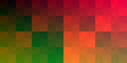

# Native renderer — primeiro incremento executável

Histórico N1. Avanços posteriores: [N2](native-renderer-n2.md),
[N3](native-renderer-n3.md), [N4.1](native-renderer-n4-1.md),
[N4.2](native-renderer-n4-2.md). Desenvolvimento Native suspenso em 15/10;
Xenos padrão. Os bloqueios abaixo descrevem o primeiro incremento.

Este documento registra N1. O incremento posterior já demonstrou Home e
navegação originais: [Native N2, evidências e limites](native-renderer-n2.md).

Estado em 2026-10-14, a partir de `c6bb760`: plugin independente com **scanout
D3D12 real**, executado na RTX 4070. Ainda não renderiza geometria de jogos nem
a dashboard. Xenos continua padrão e referência de correção. Native só aparece
na seleção do desktop após habilitar explicitamente o acesso de desenvolvimento.
Não há fallback silencioso, suporte Vulkan implementado ou ganho de FPS alegado.

## Implementação e limites

`src/native/plugin.cpp` exporta `rex_gpu_abi_version` e `rex_gpu_create` (ABI 1).
O runtime carrega `rexgpu-native{,d,rd}.dll` por `LoadGpuPlugin`, obtendo um
`IGraphicsSystem`. A DLL compila os serviços compartilhados de GraphicsSystem,
PM4 e registradores do SDK pinado, mas não o backend Xenos, tradutor de shaders,
cache de texturas, render targets ou pipelines dele. `dumpbin /dependents` e o
teste de módulos carregados confirmam ausência de dependência em rexgpu-xenos.
Provider e presenter do SDK continuam compartilhados, incluindo o mailbox de
frames e a ABI `PresentSystemFrame` usada pelos originais do sistema.

| Componente | Implementação demonstrada |
|---|---|
| Comandos/estado | Ring guest via MMIO, TYPE0, WAIT_REG_MEM, XE_SWAP, MEM_WRITE; registradores compartilhados; gate de capacidades Native |
| Memória/texturas | Snapshot da memória física guest, RGBA8 unsigned 2D, pitch, linear/tiled, quatro endiannesses, swizzle, LUT gamma de 10 bits |
| Shader/pipeline | Compute HLSL próprio, compilado uma vez; root signature e PSO próprios; não é tradução de shader guest |
| Sincronização | Três slots com allocator/list/upload próprios, fence por submissão, espera no reúso, barriers e drenagem no shutdown normal |
| Apresentação | Escrita GPU em R10G10B10A2 do presenter e captura real pelo readback do SDK |
| Falhas | Textura incompatível, draw/resolve/shader guest ou opcode não suportado encerram o filho com diagnóstico e código 78 |

Os uploads ainda copiam a textura inteira por frame. Não há cache de regiões
dirty. Slots reaproveitam capacidade e descriptors, mas isso não comprova
vantagem sobre Xenos. Capturas a cada frame sincronizam a validação; não são
teste de estresse de throughput. Remoção de device e espera acima de cinco
segundos produzem erro explícito. O encerramento de erro usa `_Exit(78)` porque
a interface atual não oferece retorno de falha assíncrona; somente o caminho
de sucesso tem shutdown normal/drenado validado.

Ausências: tradução VS/PS guest (incluindo IM_LOAD_IMMEDIATE), draws/indexação,
render targets e EDRAM, resolve, depth/stencil, blend, MSAA, formatos comprimidos,
mipmaps/packed mips, post-processing, cache de shaders/pipelines guest e Vulkan.
O gate rejeita comandos ausentes antes de o parser compartilhado poder ignorá-los.
Ele não representa cobertura completa de todos os payloads PM4 possíveis.

## Vulkan permanece no desenho

`ScanoutTexture` e `ScanoutBackend` não expõem tipos D3D12. O processador recebe
uma factory da implementação selecionada pelo plugin. Recursos, filas, barriers,
descriptors, PSO e fence estão em `d3d12_scanout.*`; a extensão Vulkan terá sua
própria implementação de backend/provider e shader SPIR-V. Não levar contratos
de recursos D3D12 para comandos, estado ou memória guest ao adicionar draw/EDRAM.

Hoje, pedir `LoadGpuPlugin("native", "vulkan")` retorna erro/null, comprovado no
teste `native.abi`; não escolhe D3D12 silenciosamente. Não há suporte Native em
builds somente Vulkan. Xenos Vulkan não foi alterado nem revalidado aqui.

## Configuração global e build

Em Configurações do desktop, **Gráficos — renderer global (próxima sessão)**:
Xenos (ReXGlue) é o padrão. O checkbox de desenvolvimento libera Native
(Experimental), avisando que a dashboard ainda não é suportada. Desmarcá-lo
restaura Xenos. A configuração é persistida em `.local/graphics.toml` do ambiente,
valendo para todos os títulos; não existe configuração por jogo. Os controles
ficam bloqueados enquanto há operação/sessão no desktop.

O supervisor lê uma única cópia após adquirir a lease da sessão, remove todas
as opções `gpu_plugin` dos manifests e aplica essa cópia a cada transição.
Dashboard, jogo e seu host de Guide usam a escolha da sessão. Uma edição
posterior só vale para outra sessão. Arquivo inválido, Native sem autorização
experimental ou DLL ausente geram erro. O loader continua responsável pela ABI
e pelo sufixo de configuração correto. O CLI diagnóstico `run` conserva seus
argumentos explícitos para probes; ele não configura uma sessão da plataforma.

O build raiz Windows/D3D12 inclui o plugin e o probe. Para preparar um título
com a DLL adicional, configurar seu build com `-DX360N_NATIVE_RENDERER=ON`;
`x360n_stage_runtime_dlls` inclui o plugin e mantém o Xenos. Essa opção de build
é desligada por padrão e não muda o renderer de execução. Não copiar DLLs de
configurações diferentes nem atualizar um recibo de preparação manualmente.
Os binários já preparados não recebem Native automaticamente.

```powershell
scripts\devshell.cmd cmake --build --preset win-amd64-release --target x360n_native_probe x360n_native_tests x360-native x360n
scripts\devshell.cmd ctest --preset win-amd64-release -R "native[.]" --output-on-failure
scripts\devshell.cmd ctest --preset win-amd64-release -R sdkcheck.Native --output-on-failure
scripts\devshell.cmd ctest --preset win-amd64-release -R renderer --output-on-failure
```

O probe gráfico é opt-in, não um teste gráfico longo automático. Exemplo, raiz
do repositório (usar caminho absoluto para a saída, pois `run` troca o diretório):

```powershell
$probe = '.local/build/win-amd64/src/native/Release/x360n_native_probe.exe'
$output = Join-Path (Get-Location) '.local/validation/native-manual'
& .local/build/win-amd64/src/supervisor/Release/x360n.exe run $probe --label native-manual --timeout 30 --crash-stack -- native $output
```

Trocar `native` por `xenos` e usar outro diretório gera a referência com o mesmo
fixture. `--abi` valida exports, argumentos inválidos, recusa Vulkan e ausência
de Xenos carregado. `--reject` envia opcode 0x7E e exige falha explícita.

## Evidência gráfica e testes

Fixture gerado pelo teste, sem recursos de jogos: textura 256×128, pitch 320,
24 variantes combinando linear/tiled, endian, RGBA/BGRA e gamma por canal.
Cada variante passa por `PresentSystemFrame` e pelo ring original (48 envios).
O compute shader faz o endereçamento/conversão na GPU; o oráculo CPU serve
apenas para verificar o readback, não para substituir a renderização.

| Execução local | Resultado |
|---|---|
| `20261014T204956Z-xenos-native-reference` | 24 capturas, 2.359.296 canais RGB, erro máximo 0, exit 0, shutdown normal |
| `20261014T205900Z-native-final` | Mesmos resultados, gate 0074 ativo, WAIT_REG_MEM no ring, sem exceção capturada |
| `20261014T210334Z-native-delivery` | Revalidação após separar a factory de backend: mesmo erro máximo 0, exit 0 e shutdown normal |
| `20261014T205933Z-native-dashboard` | Original 17559 carregou Native; IM_LOAD_IMMEDIATE recusado, exit 78 em 3,83 s, sem exceção não tratada |

Os três PNGs salvos têm SHA-256 idêntico entre Native e Xenos:

| Frame | SHA-256 |
|---|---|
| 0 | `f7fca4655ce8c4c0e4ac69ee20f53a3a2d8f3f36d6f48c43c0387626a9978223` |
| 7 | `9a62928c3386e2335c272419d4517e0add0c7476de3bd6f33e55ed1e9814380b` |
| 23 | `1f992d54482f842400c425a881ac84913ca8d4b10a13b94b33fc2f91fe03361e` |

Captura real do fixture na GPU, frame 23 (não é dashboard/jogo):



[Referência Xenos do mesmo frame](evidence/native-2026-10-14/xenos-frame-23.png).
Frames 0 e 7 também estão nessa pasta, em pares. Logs completos e reports ficam
em `.local/runs/<execução>/`; runtime logs/readbacks em
`.local/validation/native-increment-1/{native-final,xenos}/`.
A última revalidação está em `native-delivery/`, com os mesmos hashes de PNG.

Testes focados aprovados: `native.texture`, `native.abi`,
`sdkcheck.Native-packet-guard`, dois casos de configuração global e sete casos
de sessão (incluindo 80 transições sintéticas com override de manifest).
Essas transições comprovam roteamento/snapshot e handoff, não renderização
Native da dashboard/Guide/jogos. A UI foi compilada; não houve teste interativo
dos controles nem Computer Use.

O teste do patch 0074 falhou antes dele (timeout sem erro explícito) e passou
depois (exit 78 e mensagem esperada). Logs em `.local/logs/native-guard-{before,after}.log`.
`apply-sdk-patches.ps1 -Check` confirmou os 73 patches ativos; 0073 continua
retirado. Pin SDK e ABI não mudaram. A checagem condicional não é compilada no
Xenos, sem branch/callsite adicional nele.

Tentativas anteriores de desenvolvimento foram preservadas: entry point estreito
incompatível com `_get_wpgmptr` (corrigido para wmain), warning do compilador HLSL
e endereço físico calculado incorretamente (corrigido para GetPhysicalAddress).
Não são resultados positivos. Um filtro CTest amplo (`ative`) também atingiu
`extract-disc preserves partition-relative sectors and tree order`, que falhou
em `exit_code == 0`; causa não investigada neste incremento. Log preservado em
`.local/logs/native-final-tests.log`; os filtros focados posteriores passaram.

## Próximo bloqueio e medição

O teste 17559 usou uma cópia isolada do executável/módulos originais preparados,
runtime correspondente e Native rd, com user/profile root novo. Não substituiu
os binários preparados, seus recibos nem os saves. O log contém também 17 stubs
e três mensagens XLIVEBASE já fora do caminho gráfico; não é execução sem erros.
Não houve frame de dashboard demonstrado. Forza não foi iniciado nesta etapa,
pois também requer tradução de shaders, draw e EDRAM ainda ausentes.

Próximo incremento: obter o shader inline efetivamente solicitado pela 17559,
implementar decodificação/representação guest genérica e geração D3D12 com desenho
compatível com SPIR-V, depois draw/estado/render target/resolve necessários ao
primeiro frame original. Não retornar sucesso para avançar artificialmente.
Native continuará experimental até dashboard e transições reais aprovadas.

Não há comparação válida de desempenho. O tempo diagnóstico inclui inicialização,
compilação, readbacks e sincronização por captura; não deve ser convertido em
FPS nem comparado com os ~120 FPS citados para Pinyon. FPS/1% low, P95/P99,
CPU/GPU por frame, RAM/VRAM e pacing permanecem pendentes em cenas equivalentes
com fidelidade e simulação preservadas. P1/P2/P3 existentes não foram alterados.

Referências examinadas: [ReXGlue v0.10.0](https://github.com/rexglue/rexglue-sdk),
[Pinyon Shift](https://github.com/arcanite24/pinyon-shift) e seu
[executor FH1](https://github.com/arcanite24/shiftglue-sdk/blob/development/src/graphics/d3d12/fh1_native_executor.cpp).
O executor FH1 e os shader packs específicos mostram uma divisão entre comandos
guest compartilhados e execução nativa especializada. Aqui foi mantida a ABI
compartilhada e criada execução própria de scanout genérico; não se copiaram
packs de shaders nem caminhos de materiais específicos do Forza. A permutação
tiled foi adaptada do utilitário Xenia/ReXGlue pinado, com atribuição no HLSL.
